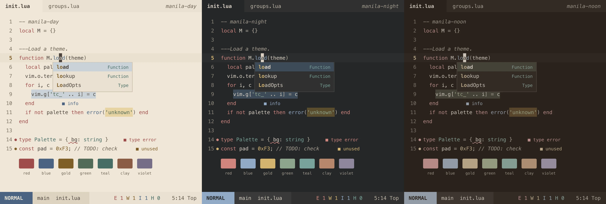

<p align="center">
  
</p>

A Neovim colorscheme with two variants, manila-day and manila-night, shaped by my perspective of Manila and its colors, weather, and everyday textures.

The Philippine flag gave me the starting palette of red, blue, yellow, and white. I did not want to reproduce it literally, so each color is faded the way paint fades in the sun. Red becomes terracotta, blue becomes a hazy sky, yellow becomes old gold, and white becomes ivory and chalk. Island green and a few earthy neutrals fill in the rest.

## Philosophy

The theme should feel like a place before it looks like a flag. A few ideas guided the choices.

**Muted, but readable.** Colors are desaturated and nothing is neon. Muted does not mean hard to read, so every foreground color was checked against its background (see Contrast below) and darkened or lightened until it held up.

**Warm, but balanced.** Warmth comes mostly from the backgrounds and neutrals. Blues and greens keep the palette from turning into one big orange.

**Few colors, used with intent.** Not every token gets its own color. Keywords, functions, strings, types, and constants each get one, and everything else stays close to the main text color. Comments, line numbers, and borders share a family of dusty neutrals that gives the theme its quiet character.

**Two moods, one palette.** Both variants use the same semantic roles, so a keyword is terracotta or coral in both and a function is blue in both. The variants are tuned separately for their backgrounds and are not inversions of each other.

### manila-day

Manila under late morning light. The background is warm ivory instead of white, and the text is a dark warm brown instead of black. Accents are deeper than their night counterparts so they stay legible on a light surface. Comments are a dusty taupe, like dust on old concrete.

### manila-night

A humid evening after rain. The background is warm charcoal and not pure black, and the text is a warm off-white. Accents are lighter and softer, with muted coral, hazy blue, rain-washed sage, and amber gold. Comments are a dusty milk tone that sits a step below the main text, so they read clearly without competing with the code.

Comments are italic in both variants.

## Palette

| Role                     | Day       | Night     |
| ------------------------ | --------- | --------- |
| Background               | `#F0E7D8` | `#252729` |
| Surface                  | `#EAE0D1` | `#2F3030` |
| Foreground               | `#4A433C` | `#D9D0C3` |
| Secondary foreground     | `#62584D` | `#BEB4A5` |
| Comments                 | `#6C6153` | `#A89F91` |
| Keywords                 | `#9F4D4A` | `#D1847D` |
| Functions                | `#4A6482` | `#91A9C5` |
| Strings                  | `#536C57` | `#8DA58D` |
| Constants and numbers    | `#7F5E28` | `#D4B36F` |
| Types                    | `#476C65` | `#78A39A` |
| Preprocessor and special | `#8A5C45` | `#B8876D` |
| Tags and attributes      | `#776E88` | `#8F879B` |

The full palette, including selection, search, diagnostics, and diff colors, lives in `lua/manila/palettes/manila-day.lua` and `lua/manila/palettes/manila-night.lua`. Every color the editor uses comes from those two files. The standalone themes in `extras/wezterm` and `extras/bat` are the exception: they repeat the same values in the formats those programs read, so they can load them without Neovim, and the smoke test checks them against the palette.

## Requirements

Neovim 0.11 or newer with true color support. The popup menu match highlighting uses the groups Neovim added in 0.11. The colorscheme turns on `termguicolors` when it loads. There is no 256 color fallback.

## Installation

With `vim.pack`, Neovim's built-in package manager (Neovim 0.12 or newer)

```lua
vim.pack.add({ "https://github.com/ryanjayleyva/manila.nvim" })
vim.cmd.colorscheme("manila-night")
```

With [lazy.nvim](https://github.com/folke/lazy.nvim)

```lua
{
  "ryanjayleyva/manila.nvim",
  lazy = false,
  priority = 1000,
  config = function()
    vim.cmd.colorscheme("manila-night")
  end,
}
```

## Usage

```vim
:colorscheme manila-day
:colorscheme manila-night
```

Switching between the two at runtime is supported and leaves no highlights behind from the previous variant.

To follow the editor background setting, you can pick a variant yourself.

```lua
vim.cmd.colorscheme(vim.o.background == "light" and "manila-day" or "manila-night")
```

There is no `setup()` function and no configuration options at the moment.

## Lualine

The theme ships statusline colors for [lualine.nvim](https://github.com/nvim-lualine/lualine.nvim). Pick the variant that matches the colorscheme.

```lua
require("lualine").setup({ options = { theme = "manila-night" } })
```

`theme = "auto"` also works, because lualine looks for a theme named after the active colorscheme.

## WezTerm

The palette also ships as a WezTerm color scheme, one Lua file per variant, in [extras/wezterm](extras/wezterm). The ANSI slots use the same colors the editor assigns to `terminal_color_0` through `terminal_color_15`, so a `:terminal` buffer and the WezTerm window around it render the same output. The cursor, selection, scrollbar, split, and tab bar colors match the Neovim UI as well.

Load the files in your `wezterm.lua` and register them under their scheme names:

```lua
local wezterm = require("wezterm")
local config = {}

local scheme_dir = "/path/to/manila.nvim/extras/wezterm"
config.color_schemes = {
  ["Manila Day"] = dofile(scheme_dir .. "/manila-day.lua"),
  ["Manila Night"] = dofile(scheme_dir .. "/manila-night.lua"),
}
config.color_scheme = "Manila Night"

return config
```

Replace `/path/to/manila.nvim` with the checkout location. The files are Lua tables, not TOML schemes, so WezTerm's `~/.config/wezterm/colors` auto-discovery does not load them. Register them in `color_schemes` explicitly. Then reload the WezTerm configuration.

## bat

The palette ships as [bat](https://github.com/sharkdp/bat) themes, one `.tmTheme` file per variant, in [extras/bat](extras/bat).

Copy the files to bat's themes directory:

```bash
mkdir -p "$(bat --config-dir)/themes"
cp /path/to/manila.nvim/extras/bat/*.tmTheme "$(bat --config-dir)/themes/"
bat cache --build
```

Replace `/path/to/manila.nvim` with the checkout location. Select the theme with `--theme=manila-day` or `--theme=manila-night`, or set `BAT_THEME` in your shell configuration.

## Coverage

- Core editor UI such as the cursor, line numbers, splits, statusline, tabline, floating windows, and the popup menu
- Vim syntax groups and Tree-sitter captures
- LSP highlights, semantic tokens, and diagnostics
- Diff and basic git highlights
- Terminal colors
- WezTerm color schemes for both variants
- Lualine themes for both variants

## Contrast

Foreground and background pairs were measured with the WCAG contrast formula. In both variants the main text, comments, and syntax colors reach at least 4.5 to 1 against the background, and the main text reaches at least 7 to 1. Line numbers and borders are intentionally quieter. Some of the colors in the original design brief did not meet these numbers, mostly in manila-day, so they were adjusted while keeping their hue.

Contrast numbers do not replace looking at real code, so some colors may still need tuning after more daily use.

## Known limitations

- Lualine is the only dedicated Neovim plugin integration. Other plugins that link to standard highlight groups will pick up the theme, and the rest may look inconsistent.
- Tree-sitter highlighting depends on the parsers you have installed. Without a parser, Neovim falls back to Vim syntax groups.
- Only a true color terminal is supported.

## License

Released under the [MIT License](LICENSE).
